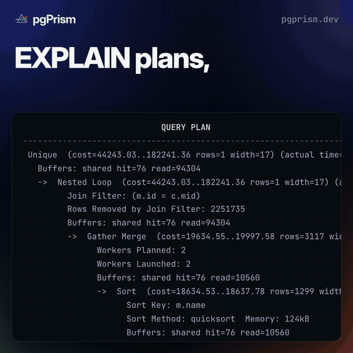
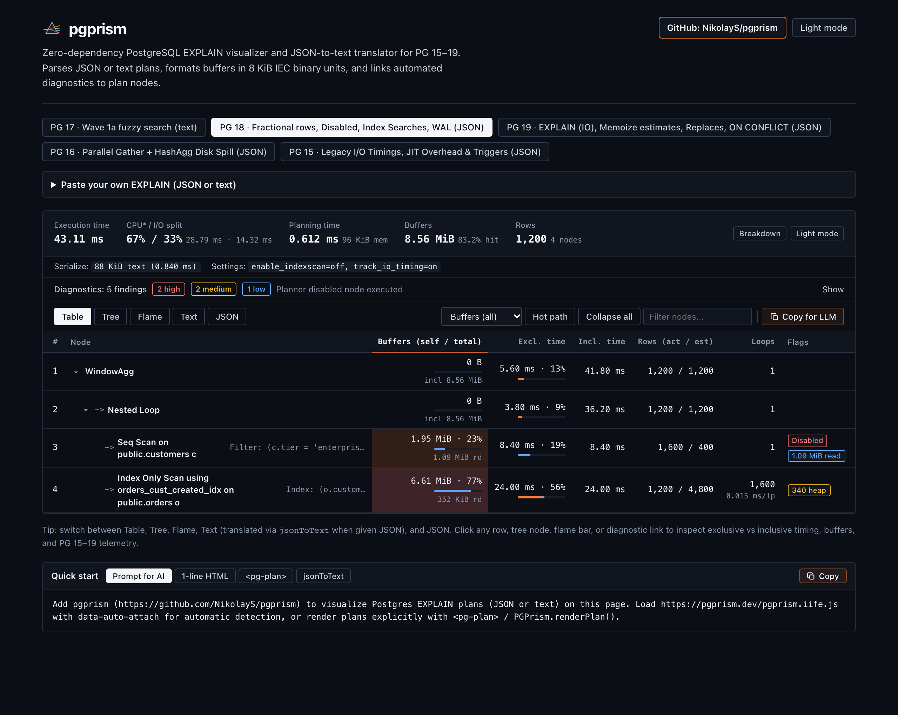
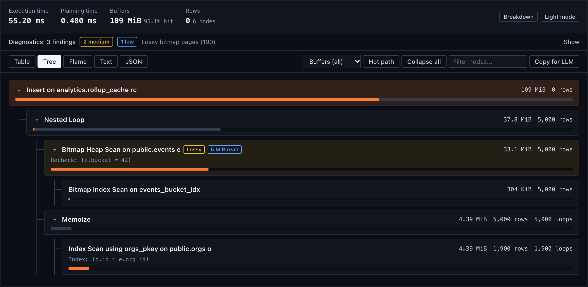
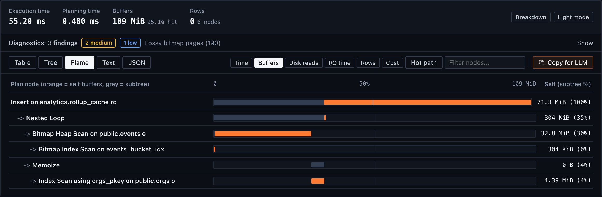
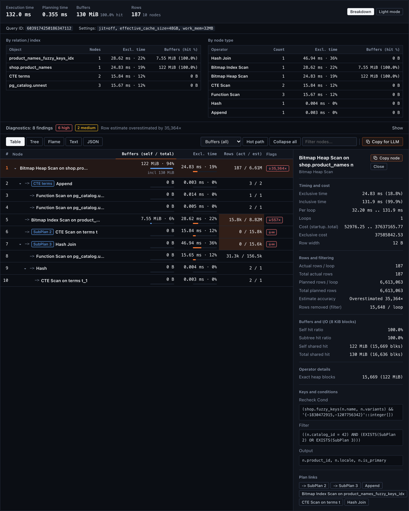
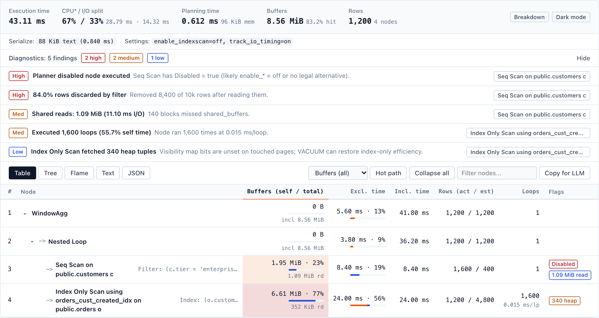

# pgPrism

**EXPLAIN plans, refracted.** A tiny, zero-dependency Postgres plan visualizer you can embed anywhere: blogs, docs, dashboards, HTML reports.

[](https://www.npmjs.com/package/pgprism)
[](https://github.com/NikolayS/pgprism/actions/workflows/ci.yml)
[](LICENSE)

**[Live demo: pgprism.dev](https://pgprism.dev/)** (mirror: [nikolays.github.io/pgprism](https://nikolays.github.io/pgprism/)) · [npm: pgprism](https://www.npmjs.com/package/pgprism) · Postgres 15 through 19

<p align="center">
  
</p>

## Quick start: one script tag

```html
<script src="https://cdn.jsdelivr.net/npm/pgprism@0.1.0-beta.1/dist/pgprism.iife.js" data-auto-attach></script>
```

Add it to any HTML page. Every `<pre>` that holds a Postgres plan, JSON or text, gets an interactive view with a toggle back to the raw text. There is no build step, no framework, and no backend: `pgPrism` runs entirely in the browser and sends the plan nowhere.

Building an app? Install from npm and use the [`<pg-plan>` tag or the API](#four-integration-modes):

```sh
npm install pgprism@0.1.0-beta.1
```

## Why pgPrism

- **Embeds anywhere.** One script tag, a `<pg-plan>` Web Component, or an npm import. Shadow DOM keeps your page's CSS and `pgPrism`'s CSS apart.
- **Tiny.** Zero dependencies. One file with styles included, about 37 KiB gzipped.
- **`BUFFERS` first.** Block counts become bytes in IEC binary units: `shared hit=16636` reads as `130 MiB`.
- **Finds what is wrong.** Row misestimates, filter discards, temp spills, lossy bitmaps, and more, each linked to its plan node.
- **Table, Tree, Flame.** Plus Text and JSON views, with one switch between buffers, disk reads, time, rows, and cost.
- **JSON to text.** `jsonToText` turns `explain (format json)` plans back into classic Postgres text.
- **Copy for LLM.** One click gives a compact Markdown brief for your coding agent (`formatForLLM`).
- **Postgres 15 through 19.** Parses JSON and text plans, including the newest `explain` fields.



## Install and pinning

For production pages, pin `0.1.0-beta.1` on jsDelivr, unpkg (`https://unpkg.com/pgprism@0.1.0-beta.1/dist/pgprism.iife.js`), or vendor `dist/pgprism.iife.js` locally. `https://pgprism.dev/pgprism.iife.js` is available as a rolling preview URL tracking latest `main`.

## Four integration modes

### Mode 1 — Zero-config auto-attach

Add `data-auto-attach` to the script tag for static blogs and HTML reports (`async` and `defer` are supported):

```html
<script
  src="https://cdn.jsdelivr.net/npm/pgprism@0.1.0-beta.1/dist/pgprism.iife.js"
  data-auto-attach
  data-mode="toggle"
  async
></script>
```

Or call `autoAttach` from JavaScript:

```ts
import { autoAttach, isLikelyExplainPlan } from 'pgprism';

const handle = autoAttach(document.body, { mode: 'toggle' }); // 'toggle' | 'replace' | 'below'
// handle.destroy() restores the original <pre> elements
```

`isLikelyExplainPlan` checks JSON keys and Postgres operator/cost headers before upgrading any `<pre>` or `<pre><code>` element, so SQL statements, `explain select ...;` queries, server logs, and normal JSON stay untouched.

### Mode 2 — Declarative HTML

Upgrade explicit `<pre data-pgprism>` blocks or `<pg-plan>` tags with zero user JavaScript:

```html
<pg-plan view="table" metric="auto">
  <pre>
Seq Scan on users  (cost=0.00..15.50 rows=550 width=32) (actual time=0.012..0.089 rows=550 loops=1)
  Buffers: shared hit=8
  </pre>
</pg-plan>
```

`<pg-plan>` accepts `plan="..."`, `<script type="application/json">`, `<script type="text/plain">`, `<pre>`, or inline text children. Keeping a `<pre>` child inside `<pg-plan>` provides progressive enhancement: viewers that block JavaScript display the raw plan text instead of an empty container.

### Mode 3 — Explicit programmatic API

Mount, update, analyze, and destroy views inside web apps or strict CSP pages:

```ts
import { renderPlan, parsePlan, analyzePlan } from 'pgprism';

const handle = renderPlan(document.getElementById('app')!, planInput, {
  theme: 'dark',
  view: 'table',
  metric: 'auto',
});

const parsed = parsePlan(planInput);
const analysis = analyzePlan(planInput);
// analysis includes diagnostics, bufferHitPercent, exclusiveCpuMs, byRelation, byNodeType

handle.update(nextPlan);
handle.destroy();
```

For strict `style-src 'self'` CSP headers, load `dist/pgprism.css` and pass `{ injectStyles: false, useShadow: false }`. DOM rendering uses Shadow DOM `adoptedStyleSheets` and CSSOM properties with zero inline `style="..."` HTML attributes.

### Mode 4 — Standalone `jsonToText` translator

Import `jsonToText` from the main package or the lightweight `pgprism/json-to-text` subpath (no DOM or CSS included):

```ts
import { jsonToText } from 'pgprism/json-to-text';

const jsonPlan = `[{
  "Plan": {
    "Node Type": "Seq Scan",
    "Relation Name": "orders",
    "Alias": "o",
    "Startup Cost": 0.00,
    "Total Cost": 22.50,
    "Plan Rows": 500,
    "Plan Width": 16,
    "Actual Startup Time": 0.015,
    "Actual Total Time": 0.420,
    "Actual Rows": 500,
    "Actual Loops": 1,
    "Shared Hit Blocks": 12,
    "Shared Read Blocks": 4
  },
  "Planning Time": 0.145,
  "Execution Time": 0.455
}]`;

console.log(jsonToText(jsonPlan));
// Seq Scan on orders o  (cost=0.00..22.50 rows=500 width=16) (actual time=0.015..0.420 rows=500 loops=1)
//   Buffers: shared hit=12 read=4
// Planning Time: 0.145 ms
// Execution Time: 0.455 ms
```

`jsonToText` follows `gitlab.com/postgres-ai/joe` (`pkg/pgexplain`) and Postgres `src/backend/commands/explain.c` conventions across Postgres 15–19, including `Settings:` and `Query Identifier:` footer placement before `Planning:`, omitted zero WAL fields, `Planning` `Memory`, `Serialization`, `WAL FPI Bytes`, `Memoize` estimates, and `explain (io)` metrics.

## Markdown briefs for coding agents (`formatForLLM`)

Every `<pg-plan>` toolbar includes **Copy for LLM**, and the Node Inspector includes **Copy node**. Both run `formatForLLM` to produce compact Markdown with headline stats, CPU\* / I/O split, severity-ranked diagnostics, top relations by exclusive time and buffers, predicates, and the text plan for Claude Code / Antigravity / Codex / etc.:

```ts
import { formatForLLM } from 'pgprism';

const fullMarkdown = formatForLLM(planInput);
const nodeMarkdown = formatForLLM(planInput, { nodeId: 'n3' });
```

## Views and the `BUFFERS`-first default

`metric="auto"` (the default) treats page work as primary:

- **With `BUFFERS` data**: highlights **Buffers** (`self` + `% of total` + 0-based heatbar + `inclusive`) right beside the node name in Table view and uses `buffers` in Tree/Flame.
- **Without `BUFFERS` (`ANALYZE` only)**: falls back to **Exclusive time** and flags an info tip suggesting `explain (analyze, buffers)`.
- **Estimate-only plans**: falls back to **Cost**.

You can switch metrics dynamically (`buffers`, `diskReads`, `exclusiveTime`, `inclusiveTime`, `ioTime`, `rows`, `cost`) across Table, Tree, and Flame views.

| Tree view (dark) | Flame view on Buffers |
| --- | --- |
|  |  |

| Breakdown and Node Inspector | Light mode with Diagnostics |
| --- | --- |
|  |  |

- **Summary and Breakdown**: displays execution/planning time, buffer cache hit %, **CPU\* vs I/O time split** when `I/O Timings` are present, and collapsible **By relation / index** and **By node type** tables.
- **Table view**: exclusive and inclusive metrics, `loops x avg` per-loop cost visibility, 0-based bars, heat shading, and automatic dimming/hiding for `(never executed)` branches.
- **Tree and Flame views**: collapsible tree connectors and 0-based Flame spans with quick metric pills (`Time`, `Buffers`, `Disk reads`, `I/O time`, `Rows`, `Cost`).
- **Node Inspector**: exclusive vs subtree buffer hit ratios, worker tables, clickable **Plan links** to jump directly to `CTE` / `SubPlan` / `InitPlan` targets, and `Copy node`.
- **Diagnostics**: flags row misestimates (`>= 10x`), filter discards (`>= 80%`), temp spills, lossy bitmaps, index-only heap fetches, worker shortfalls, `Memoize` cache misses, disabled nodes, high JIT share, and missing `BUFFERS`.

## Supported Postgres 15–19 features

- **Execution model**: parallel `Gather` / `Gather Merge` wall-clock concurrency, lazy `CTE` `InitPlan` accounting, `(never executed)` dimming/filtering, `TIMING OFF`, `COSTS OFF`, and exact 19-digit signed 64-bit `Query Identifier` preservation from JSON strings.
- **Postgres 15–16**: legacy `I/O Read/Write Time`, JIT timings, triggers, `Memoize`, `Right Anti Join`, and `HashAggregate` disk/partition spills.
- **Postgres 17**: `Planning` `Memory` (`used` / `allocated`), `Serialization` (`time`, `output`, `format`, buffers), split `Shared` / `Local` / `Temp` I/O timings, `Right Semi Join`, and `WindowAgg` `Run Condition`.
- **Postgres 18**: fractional `Actual Rows`, `Disabled: true`, `Index Searches`, tuplestore `Storage` / `Maximum Storage`, `WAL Buffers Full`, and `Window` definitions.
- **Postgres 19**: `Replaces` on `Result`, `WAL FPI Bytes`, `Memoize` planner estimates, `explain (io)` prefetch/I/O counters, and `ModifyTable` `on conflict` metrics.

## Build, tests, and credits

```sh
npm install
npm run check
```

To run the live `psql` regression suite against Postgres 15–18 (comparing both `FORMAT JSON` and `FORMAT TEXT` parsing plus `jsonToText` fidelity):

```sh
PGHOST=127.0.0.1 PGUSER=postgres PGPASSWORD=postgres npm run test:psql
```

`pgPrism` draws design and Postgres-engineering inspiration from [Dalibo PEV2](https://github.com/dalibo/pev2), [depesz](https://explain.depesz.com/), Datadog query plans, [pgMustard](https://www.pgmustard.com/), and [explain.tensor.ru](https://explain.tensor.ru/), along with JSON-to-text formatting patterns from [Joe (`pgexplain`)](https://gitlab.com/postgres-ai/joe).

Apache-2.0 license.
